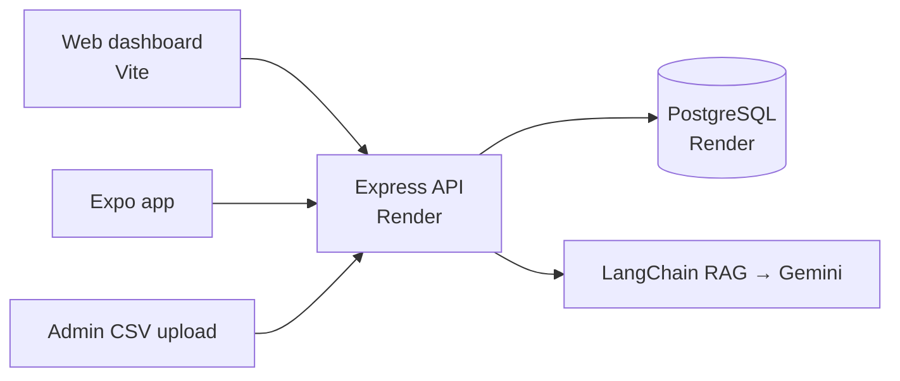

# RosterVision (FanDuel Dashboard)

A fantasy-football roster dashboard for FanDuel players. Admins upload the weekly FanDuel player CSVs; the app stores players and weekly stats, generates optimised rosters, and shows them in a filterable web dashboard and a companion Expo mobile app. A Gemini-powered chat assistant with RAG indexing over the project answers questions in context.

> This is the public snapshot (Jan 2026) of the `FanDuelDashboard` project that is developed in [dogbewX/antigrav](https://github.com/dogbewX/antigrav).

---

## Current features

**Web app**
- Login / register backed by PostgreSQL; **Admin** button and panel visible only to `role: admin`
- Admin CSV upload of FanDuel data with import validation
- Roster Vision dashboard — optimised rosters with filtering
- AI assistant on **Gemini 2.0** with full-project RAG indexing and rate-limit handling
- Unit tests (Vitest) for `dataProcessor` and `importValidation`

**Mobile app (Expo)**
- Roster viewing against the live Render API, week selection, FPPG shown to one decimal, mobile-optimised layout
- Biometric unlock (`expo-local-authentication`); Jest regression suite for `RosterContext` and App smoke tests

**Backend**
- Express API: `/api/auth/register`, `/api/auth/login`, `/api/players`, `/api/players/import`, `/api/rosters`, `/api/rosters/:userId`, `/api/rosters/latest/:userId`, `/api/ai/chat`, `/api/ai/index`, `/api/health`
- Schema bootstrap (`init_db.js`, `schema.sql`): `user_types`, `users`, `players`, `weekly_stats`, `rosters`, `roster_entries`

---

## Technology stack

| Layer | Technology |
|---|---|
| Web | JavaScript modules + Vite; Vitest/jsdom |
| API | Node.js, Express 4, `pg`, `bcrypt`, `cors`, `dotenv` |
| AI | LangChain (`@langchain/google-genai`, `@langchain/community`, `@langchain/openai`), Google Gemini |
| Mobile | Expo SDK 54, React Native, React Navigation, Axios, Jest |
| Database / hosting | PostgreSQL and Node web service on **Render** (AWS alternative documented) |

---

## Architecture



---

## Dependencies

**Server:** `express`, `pg`, `bcrypt`, `cors`, `dotenv`, `@langchain/core`, `@langchain/community`, `@langchain/google-genai`, `@langchain/openai` · dev `nodemon`
**Web:** `@google/generative-ai`, `langchain`, `@langchain/*`, `express`, `pg`, `bcrypt` · dev `vite`, `vitest`, `jsdom`
**Mobile:** `expo`, `react-native`, `@react-navigation/*`, `axios`, `expo-local-authentication` · dev `jest`, `jest-expo`, `react-test-renderer`

---

## Repository structure

```
src/              web app — login.js, register.js, admin.js, ai-chat.js/html, dataProcessor.js, services/
server/           Express API — index.js, config.js, init_db.js, schema.sql, services/
mobile-app/       Expo app — src/screens, src/context, src/services
public/ dist/     static assets and build output
scripts/          data helpers
documentation/    QUICKSTART, STARTUP_GUIDE, MAC_SETUP_GUIDE, MOBILE_BUILD_GUIDE, API_REFERENCE,
                  DATABASE_SCHEMA (+ erd.png), APP_WORKFLOWS, DEPLOYMENT_GUIDE(_AWS), PROJECT_STATUS, ScaleIssues
```

---

## Getting started

```bash
npm install && (cd server && npm install)
cp server/.env.example server/.env    # PORT, DB_HOST, DB_USER, DB_PASSWORD, DB_PORT, DB_NAME, GOOGLE_API_KEY
node server/init_db.js
npm start                              # API
npm run dev                            # web
cd mobile-app && npm install && npx expo start
```
See `documentation/QUICKSTART.md` and `MOBILE_BUILD_GUIDE.md` for platform details.

## Status

MVP2 snapshot, Jan 2026. Ongoing development happens in `antigrav/FanDuelDashboard`.
